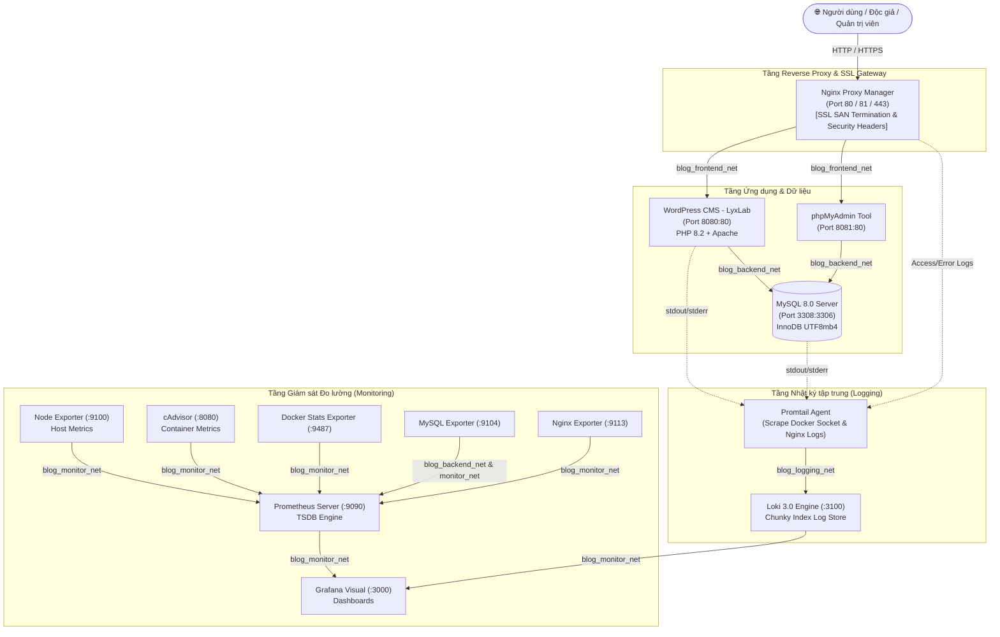

# 🚀 BÁO CÁO THỰC HÀNH TRIỂN KHAI VÀ QUẢN TRỊ HỆ THỐNG PHẦN MỀM
> **Trường Đại học Công nghệ Thông tin và Truyền thông – Đại học Thái Nguyên (ICTU)**  
> **Khoa:** Công nghệ Thông tin  
> **Học phần:** Triển khai và Quản trị Hệ thống Phần mềm  
> **Đề tài 7:** Xây dựng, Triển khai và Quản trị Hệ thống Blog CMS  
> **Sản phẩm:** Cổng thông tin & Nghiên cứu Công nghệ - **LyxLab**  
> **Sinh viên thực hiện:** `cyberbount`  
> **Repository:** [https://github.com/cyberbount/H-th-ng-Blog-CMS.git](https://github.com/cyberbount/H-th-ng-Blog-CMS.git)

---

## 📌 MỤC LỤC
1. [Tổng quan Kiến trúc Hệ thống](#1-tổng-quan-kiến-trúc-hệ-thống)
2. [Cấu trúc Thư mục Dự án](#2-cấu-trúc-thư-mục-dự-án)
3. [Bảng Tra cứu Dịch vụ & Tài khoản Phân quyền (RBAC)](#3-bảng-tra-cứu-dịch-vụ--tài-khoản-phân-quyền-rbac)
4. [Nghiệp vụ Blog CMS (Chuyên mục, Bài viết & Bình luận)](#4-nghiệp-vụ-blog-cms-chuyên-mục-bài-viết--bình-luận)
5. [Hướng dẫn Cài đặt & Khởi chạy Nhanh](#5-hướng-dẫn-cài-đặt--khởi-chạy-nhanh)
6. [Quy trình Triển khai theo 3 Mốc Git Commit](#6-quy-trình-triển-khai-theo-3-mốc-git-commit)
7. [Hệ thống Giám sát Metrics (Prometheus + Grafana)](#7-hệ-thống-giám-sát-metrics-prometheus--grafana)
8. [Hệ thống Quản lý Log tập trung (Loki + Promtail + LogQL)](#8-hệ-thống-quản-lý-log-tập-trung-loki--promtail--logql)
9. [Kiểm chứng Cơ sở dữ liệu trong phpMyAdmin](#9-kiểm-chứng-cơ-sở-dữ-liệu-trong-phpmyadmin)
10. [Các Biện pháp Bảo mật Hệ thống (System Hardening)](#10-các-biện-pháp-bảo-mật-hệ-thống-system-hardening)
11. [Xử lý Sự cố Thường gặp (Troubleshooting)](#11-xử-lý-sự-cố-thường-gặp-troubleshooting)

---

## 1. Tổng quan Kiến trúc Hệ thống

Hệ thống được thiết kế theo mô hình đa tầng micro-services, đóng gói **100% bằng 13 Docker Containers** trên nền tảng Docker Compose, phân chia thành 4 phân vùng mạng độc lập:



---

## 2. Cấu trúc Thư mục Dự án

Dự án áp dụng mô hình phân tách **Module hóa (Modular Compose)** theo chuẩn công nghiệp:

```text
.
├── compose/
│   ├── docker-compose.app.yml          # Module 1: Ứng dụng lõi (WordPress, MySQL, phpMyAdmin, NPM)
│   ├── docker-compose.monitoring.yml   # Module 2: Giám sát (Prometheus, Grafana, 5 Exporters)
│   └── docker-compose.logging.yml      # Module 3: Thu thập Log (Loki, Promtail)
├── docker-compose.yml                  # Root Compose hợp nhất 3 modules & khai báo networks/volumes
├── monitoring/
│   ├── prometheus/
│   │   └── prometheus.yml              # Cấu hình các Job scrape metrics của Prometheus chu kỳ 15s
│   ├── mysqld-exporter/
│   │   └── .my.cnf                     # File credentials an toàn cho MySQL Exporter
│   └── grafana/
│       └── provisioning/
│           ├── datasources/
│           │   └── datasources.yml     # Nạp tự động Data Source Prometheus và Loki
│           └── dashboards/
│               ├── dashboards.yml      # Auto-discovery Grafana dashboards
│               └── docker-containers.json
├── logging/
│   ├── loki-config.yaml                # Cấu hình retention, chunking và schema của Loki
│   └── promtail-config.yaml            # Cấu hình scrape Docker socket & Nginx access logs
├── nginx/
│   ├── custom/
│   │   └── stub_status.conf            # Endpoint cấp số liệu connections cho Nginx Exporter
│   └── ssl/
│       ├── nginx-selfsigned.crt        # Chứng chỉ SSL tự ký có Subject Alternative Name (SAN)
│       └── nginx-selfsigned.key        # Private key SSL tương ứng
├── .env.example                        # Mẫu cấu hình tham số môi trường
├── README.md                           # Tài liệu hướng dẫn & Báo cáo kỹ thuật chi tiết
└── De_Tai_Thuc_Hanh - TKQT HTPM K23.pdf # Đề bài thực hành ICTU
```

---

## 3. Bảng Tra cứu Dịch vụ & Tài khoản Phân quyền (RBAC)

### 3.1. Các Cổng Truy cập Dịch vụ

| Dịch vụ | Địa chỉ URL truy cập | Mô tả & Chức năng |
| :--- | :--- | :--- |
| **LyxLab Blog CMS** | `https://localhost` *(Khuyên dùng)*<br>`http://localhost:8080` | Giao diện tin tức công nghệ, bài viết và bình luận |
| **Nginx Proxy Manager** | `http://localhost:81` | Quản lý Reverse Proxy, SSL, bảo vệ Header |
| **phpMyAdmin** | `http://localhost:8081` | Quản lý trực quan CSDL MySQL `wordpress_db` |
| **Prometheus TSDB** | `http://localhost:9090` | Thu thập metrics hệ thống, kiểm tra Targets |
| **Grafana Dashboard** | `http://localhost:3000` | Trực quan hóa số liệu tài nguyên máy chủ và log |
| **Loki Log Server** | `http://localhost:3100` | Kho lưu trữ và truy vấn LogQL tập trung |
| **MySQL Server** | Host: `127.0.0.1` - Port `3308` | CSDL quan hệ lưu trữ thực tế |

---

### 3.2. Ma trận Phân quyền Tài khoản Người dùng (RBAC Matrix)

Hệ thống đáp ứng trọn vẹn mô hình phân quyền 3 cấp độ (Admin, Author, Reader) tương thích với tiêu chí thẩm định:

| Vai trò (Role) | Tên tài khoản | Mật khẩu truy cập | Quyền hạn & Phạm vi chức năng |
| :--- | :--- | :--- | :--- |
| **Quản trị viên (Administrator)** | `bount` | `Admin@LyxLab#2026!` | Quản trị toàn quyền website, cài đặt plugin, quản lý người dùng, duyệt bình luận, quản lý chuyên mục. |
| **Tác giả (Author / Biên tập)** | `tacgia_k23` | `TacGia@K23A#2026` | Biên soạn bài viết mới, tải lên ảnh bìa, chỉnh sửa bài viết của chính mình, phản hồi bình luận độc giả. |
| **Độc giả (Reader / Subscriber)** | `docgia_k23` | `DocGia@K23A#2026` | Xem bài viết, tìm kiếm thông tin, lọc theo danh mục, gửi bình luận trao đổi thảo luận kỹ thuật. |
| **Database User (phpMyAdmin)** | `wp_user` | `WP_SecurePassword2026!` | Quyền hạn DDL/DML trên database nghiệp vụ `wordpress_db`. |
| **Grafana Monitoring** | `admin` | `GrafanaAdminSecurePass2026!` | Xem và chỉnh sửa Dashboards, truy vấn Log Explore. |

---

## 4. Nghiệp vụ Blog CMS (Chuyên mục, Bài viết & Bình luận)

### 4.1. Hệ thống Chuyên mục Nghiên cứu (Categories)
1. **DevOps & Cloud** (`/category/devops-cloud`): Nghiên cứu kiến trúc Container, Microservices, CI/CD Pipeline.
2. **Hệ thống & Mạng** (`/category/system-networking`): Quản trị Linux Server, cấu hình Nginx Reverse Proxy, SSL.
3. **An toàn thông tin** (`/category/cyber-security`): Kỹ thuật Hardening hệ thống, phòng chống leo thang đặc quyền, phân tích nhật ký an ninh.
4. **Dự án Lab** (`/category/lab-projects`): Các báo cáo thực nghiệm môn Triển khai & Quản trị HTPM K23A.

### 4.2. Thanh Menu Điều hướng (Header Navigation)
Được cấu hình bằng tiếng Việt chuẩn mực:
`Trang chủ` ➔ `DevOps & Cloud` ➔ `Hệ thống & Mạng` ➔ `An toàn thông tin` ➔ `Dự án Lab`.

### 4.3. Cơ chế Bình luận Phân cấp (Threaded / Nested Comments)
- **Tương tác thực tế:** Độc giả `docgia_k23` đặt câu hỏi kỹ thuật bên dưới bài viết.
- **Phản hồi từ Admin/Tác giả:** Tài khoản `bount` (Admin) và `tacgia_k23` (Tác giả) phản hồi lồng nhau dạng cây phân cấp (`comment_parent > 0`), minh họa trọn vẹn luồng tương tác người dùng.

### 4.4. Hệ thống Thiết kế Giao diện Hiện đại (Design System - Inspired by baoyu-design)
Giao diện blog được thiết kế và tinh chỉnh theo tiêu chuẩn **Modern Tech & Security Research Blog** dựa trên phương pháp luận thiết kế cao cấp:
- **Astra Modern Framework:** Thay thế giao diện cơ bản bằng cấu trúc blog 2 cột thoáng đãng, tốc độ tải trang nhanh và tối ưu trải nghiệm người dùng.
- **Hero Dashboard Banner (`lyxlab-hero.php`):** Tích hợp banner chào mừng phong cách kỹ sư công nghệ với **Live Pulse Dot** thông báo trạng thái vận hành của 13 Containers, Nginx SSL, Prometheus và Loki.
- **Category Gradient Accent Bars:** Mỗi thẻ bài viết tự động hiển thị dải màu nhận diện chuyên mục tương ứng:
  - `DevOps & Cloud`: Dải màu Xanh dương / Cyan (`#2563eb ➔ #38bdf8`)
  - `Hệ thống & Mạng`: Dải màu Xanh lục / Emerald (`#16a34a ➔ #34d399`)
  - `An toàn thông tin`: Dải màu Đỏ thẫm / Rose (`#e11d48 ➔ #fb7185`)
  - `Dự án Lab`: Dải màu Tím / Violet (`#7c3aed ➔ #a78bfa`)
- **Developer Code Blocks:** Khối mã nguồn CSS/Command định dạng Terminal tối màu (`#0f172a`), font monospace (`JetBrains Mono / Fira Code`), hỗ trợ hiển thị code dễ đọc.
- **Sidebar Tiện ích:** Tích hợp hộp tìm kiếm với focus ring, danh mục hiển thị số lượng bài, bài viết mới nhất và khối điều hướng đăng nhập/quản trị.

---

## 5. Hướng dẫn Cài đặt & Khởi chạy Nhanh

### Yêu cầu tiên quyết:
- Đã cài đặt **Docker Engine** (24.0+) và **Docker Compose v2**.
- Môi trường: Linux Ubuntu hoặc Windows (WSL2 Ubuntu 22.04/24.04).

### Các bước khởi chạy 1-Click:

```bash
# 1. Clone kho lưu trữ dự án
git clone https://github.com/cyberbount/H-th-ng-Blog-CMS.git
cd H-th-ng-Blog-CMS

# 2. Tạo file cấu hình môi trường từ mẫu
cp .env.example .env

# 3. Khởi chạy toàn bộ 13 containers trong chế độ nền
docker compose up -d

# 4. Kiểm tra trạng thái hoạt động của toàn bộ dịch vụ
docker compose ps
```

---

## 6. Quy trình Triển khai theo 3 Mốc Git Commit

Dự án được phân chia thành 3 commit logic rõ ràng, tuân thủ tuyệt đối quy định chấm điểm:

```text
* fee569c (HEAD -> main) feat: integrate Loki and Promtail for centralized logging with LogQL and system hardening
* be9a13a feat: integrate Prometheus and Grafana for infrastructure and service monitoring
* f12b685 feat: initial project structure with WordPress, MySQL, phpMyAdmin and Nginx Reverse Proxy
```

* **Mốc 1 (`f12b685`):** Xây dựng nền tảng ứng dụng (WordPress + MySQL + phpMyAdmin) và cổng Nginx Reverse Proxy SSL.
* **Mốc 2 (`be9a13a`):** Tích hợp hạ tầng giám sát chuỗi thời gian (Prometheus + Grafana + 5 Exporters).
* **Mốc 3 (`fee569c`):** Hoàn thiện thu thập log tập trung (Loki + Promtail + LogQL) và áp dụng các biện pháp Hardening bảo mật.

---

## 7. Hệ thống Giám sát Metrics (Prometheus + Grafana)

### 7.1. Trạng thái Targets trong Prometheus (`http://localhost:9090/targets`)
Tất cả 5 nhóm exporter đều đạt trạng thái **`HEALTH: UP (1/1)`**:
- `node-exporter:9100`: Giám sát tài nguyên phần cứng máy chủ (CPU, Memory, Disk, Network).
- `mysqld-exporter:9104`: Giám sát MySQL Queries/sec, Connections, Threads, InnoDB Buffer Pool.
- `nginx-exporter:9113`: Giám sát lưu lượng Active Connections, Handled Requests của Nginx.
- `cadvisor:8080`: Thu thập thống kê CPU/RAM chi tiết của từng Docker Container.
- `docker-stats:9487`: Cung cấp metrics từ Docker Daemon Socket.

### 7.2. Các câu truy vấn PromQL Tiêu biểu
Dùng để kiểm chứng trạng thái sống của dịch vụ:
```promql
# 1. Kiểm tra trạng thái máy chủ cơ sở dữ liệu MySQL (1 = Up, 0 = Down)
mysql_up == 1

# 2. Kiểm tra trạng thái Reverse Proxy Nginx
nginx_up == 1

# 3. Xem phần trăm sử dụng CPU của máy chủ
100 - (avg by (instance) (rate(node_cpu_seconds_total{mode="idle"}[1m])) * 100)

# 4. Đếm số lượng Container đang ở trạng thái chạy
count(container_last_seen)
```

---

## 8. Hệ thống Quản lý Log tập trung (Loki + Promtail + LogQL)

### 8.1. Cơ chế Thu thập
Promtail giám sát đồng thời:
1. Docker socket `/var/run/docker.sock` ➔ Tự động gắn nhãn `container="tên_container"`.
2. Thư mục tệp tin nhật ký của Nginx Proxy Manager ➔ Đánh nhãn `job="nginx"`.

### 8.2. Hướng dẫn Truy vấn LogQL trên Grafana (`http://localhost:3000/explore`)
*(Lưu ý: Đổi Data Source trên đầu trang thành **Loki**)*

#### Query 1: Lọc dòng log của dịch vụ WordPress
```logql
{container="blog-wordpress"}
```

#### Query 2: Bắt toàn bộ lỗi HTTP (mã trạng thái 4xx hoặc 5xx) từ Nginx
```logql
{container="blog-npm"} |~ "HTTP/[0-9.]+ (4[0-9]{2}|5[0-9]{2})"
```

#### Query 3: Tìm kiếm các dấu hiệu bất thường (Error, Warn, Exception)
```logql
{container=~".+"} |~ "(?i)error|warn|exception"
```

#### Query 4: Đếm tần suất phát sinh nhật ký theo thời gian thực (Cửa sổ 5 phút)
```logql
rate({container="blog-npm"}[5m])
```

---

## 9. Kiểm chứng Cơ sở dữ liệu trong phpMyAdmin

Để minh chứng tính toàn vẹn và quan hệ dữ liệu trong cơ sở dữ liệu `wordpress_db` (`http://localhost:8081`):

1. **Bảng `wp_users`:** Lưu danh sách tài khoản phân quyền (`bount` - Admin, `tacgia_k23` - Author, `docgia_k23` - Subscriber).
2. **Bảng `wp_posts`:** Lưu trữ toàn bộ bài viết kỹ thuật, ảnh bìa, với trạng thái `post_status = 'publish'`.
3. **Bảng `wp_terms` & `wp_term_taxonomy`:** Lưu danh mục chuyên môn và cây cấu trúc danh mục.
4. **Bảng `wp_comments`:** Lưu bình luận của độc giả; trường `comment_parent` xác định quan hệ trả lời lồng nhau.

---

## 10. Các Biện pháp Bảo mật Hệ thống (System Hardening)

Tuân thủ nghiêm ngặt các tiêu chuẩn bảo mật hệ thống thông tin:

1. **Phân vùng mạng độc lập (Network Segmentation):**
   - `blog_frontend_net`: Tiếp nhận lưu lượng người dùng, chỉ chứa `npm`, `wordpress`, `phpmyadmin`.
   - `blog_backend_net`: **Cô lập hoàn toàn MySQL Database**, chỉ cho phép WordPress và phpMyAdmin trao đổi; Nginx và mạng ngoài không thể kết nối trực tiếp.
   - `blog_monitor_net` & `blog_logging_net`: Các kênh giám sát và thu thập log hoàn toàn riêng biệt.
2. **Giới hạn tài nguyên phần cứng (Resource Limits):**
   - Thiết lập ngưỡng trần CPU và RAM cho từng container, chống tấn công DoS/OOM làm tê liệt host.
3. **Chống leo thang đặc quyền (Privilege Escalation Prevention):**
   - Cấu hình cờ `security_opt: - no-new-privileges:true` trên toàn bộ các container dịch vụ.
4. **Bảo vệ Secret & Biến môi trường:**
   - Tập tin nhạy cảm `.env` được đưa vào `.gitignore`, cung cấp mẫu `.env.example` an toàn khi chia sẻ mã nguồn.
5. **Mã hóa đường truyền:**
   - Kích hoạt SSL/TLS tự ký chuẩn SAN cho giao thức HTTPS trên cổng 443.

---

## 11. Xử lý Sự cố Thường gặp (Troubleshooting)

### 1. Grafana báo lỗi `parse error: unexpected character: '|'` khi chạy LogQL
- **Nguyên nhân:** Đang chọn nhầm Data Source `Prometheus`.
- **Khắc phục:** Chuyển Data Source sang **`Loki`** trên thanh chọn ở góc trên bên trái màn hình Explore.

### 2. Lỗi xung đột cổng `3306` trên máy tính cá nhân
- **Khắc phục:** Hệ thống ánh xạ cổng ra máy chủ là **`3308:3306`**, không xung đột với MySQL cài sẵn của hệ điều hành.

### 3. Cảnh báo SSL self-signed trên trình duyệt
- **Khắc phục:** Nhấn *Advanced (Nâng cao)* -> *Proceed to localhost (Tiếp tục truy cập)* do chứng chỉ được tạo bằng OpenSSL tự ký phục vụ môi trường thực hành nội bộ.
