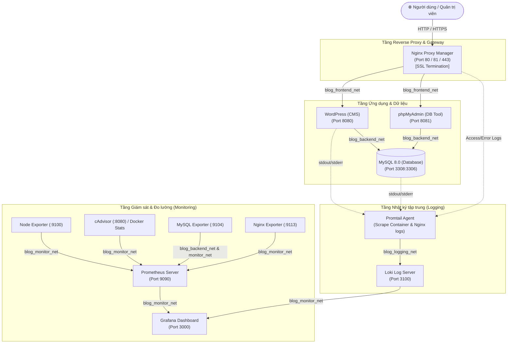

# 🚀 BÁO CÁO THỰC HÀNH TRIỂN KHAI VÀ QUẢN TRỊ HỆ THỐNG PHẦN MỀM
> **Trường Đại học Công nghệ Thông tin và Truyền thông – Đại học Thái Nguyên (ICTU)**  
> **Học phần:** Triển khai và Quản trị Hệ thống Phần mềm  
> **Đề tài:** Hệ thống Blog / CMS (WordPress + MySQL + phpMyAdmin + Nginx + Prometheus + Grafana + Loki)  
> **Sinh viên thực hiện:** `cyberbount`  
> **Repository:** [https://github.com/cyberbount/H-th-ng-Blog-CMS.git](https://github.com/cyberbount/H-th-ng-Blog-CMS.git)

---

## 📌 MỤC LỤC
1. [Tổng quan Kiến trúc Hệ thống](#1-tổng-quan-kiến-trúc-hệ-thống)
2. [Cấu trúc Thư mục Dự án](#2-cấu-trúc-thư-mục-dự-án)
3. [Bảng Tra cứu Dịch vụ & Tài khoản Truy cập](#3-bảng-tra-cứu-dịch-vụ--tài-khoản-truy-cập)
4. [Hướng dẫn Cài đặt & Khởi chạy Nhanh](#4-hướng-dẫn-cài-đặt--khởi-chạy-nhanh)
5. [Quy trình Triển khai theo 3 Mốc Git Commit](#5-quy-trình-triển-khai-theo-3-mốc-git-commit)
6. [Hệ thống Giám sát Metrics (Prometheus + Grafana)](#6-hệ-thống-giám-sát-metrics-prometheus--grafana)
7. [Hệ thống Quản lý Log tập trung (Loki + Promtail + LogQL)](#7-hệ-thống-quản-lý-log-tập-trung-loki--promtail--logql)
8. [Các Biện pháp Bảo mật Hệ thống (System Hardening)](#8-các-biện-pháp-bảo-mật-hệ-thống-system-hardening)
9. [Xử lý Sự cố Thường gặp (Troubleshooting)](#9-xử-lý-sự-cố-thường-gặp-troubleshooting)

---

## 1. Tổng quan Kiến trúc Hệ thống

Hệ thống được thiết kế theo mô hình Microservices hiện đại, đóng gói 100% bằng Docker và quản lý tập trung thông qua Docker Compose:



---

## 2. Cấu trúc Thư mục Dự án

Dự án áp dụng mô hình phân tách **Module hóa (Modular Compose)**:

```text
.
├── compose/
│   ├── docker-compose.app.yml          # Module 1: Ứng dụng lõi (WordPress, MySQL, phpMyAdmin, NPM)
│   ├── docker-compose.monitoring.yml   # Module 2: Giám sát (Prometheus, Grafana, 4 Exporters)
│   └── docker-compose.logging.yml      # Module 3: Thu thập Log (Loki, Promtail)
├── docker-compose.yml                  # Root Compose sử dụng include nạp cả 3 modules
├── monitoring/
│   ├── prometheus/
│   │   └── prometheus.yml              # Cấu hình các Job scrape metrics của Prometheus
│   ├── mysqld-exporter/
│   │   └── .my.cnf                     # File cấu hình thông tin đăng nhập an toàn cho MySQL Exporter
│   └── grafana/
│       └── provisioning/
│           ├── datasources/
│           │   └── datasources.yml     # Tự động nạp sẵn Data Source Prometheus và Loki
│           └── dashboards/
│               ├── dashboards.yml      # Cấu hình tự động scan dashboard
│               └── docker-containers.json
├── logging/
│   ├── loki-config.yaml                # Cấu hình lưu trữ và phân vùng chunks của Loki
│   └── promtail-config.yaml            # Cấu hình thu thập log Docker socket & Nginx logs
├── nginx/
│   ├── custom/
│   │   └── stub_status.conf            # Endpoint phục vụ cào metrics lưu lượng Nginx
│   └── ssl/
│       ├── nginx-selfsigned.crt        # Chứng chỉ SSL tự ký có hỗ trợ SAN (Subject Alternative Name)
│       └── nginx-selfsigned.key        # Private key tương ứng của chứng chỉ
├── .env.example                        # Mẫu cấu hình biến môi trường
├── README.md                           # Tài liệu hướng dẫn chi tiết
└── De_Tai_Thuc_Hanh - TKQT HTPM K23.pdf # Đề bài thực hành ICTU
```

---

## 3. Bảng Tra cứu Dịch vụ & Tài khoản Truy cập

| Tên Dịch vụ | Địa chỉ URL truy cập | Tài khoản / Thông tin xác thực | Chức năng chính |
| :--- | :--- | :--- | :--- |
| **WordPress Web** | `http://localhost:8080`<br>`https://localhost` | Khởi tạo tài khoản Quản trị khi truy cập lần đầu | Website Tin tức / Blog CMS |
| **phpMyAdmin** | `http://localhost:8081` | **User:** `wp_user`<br>**Password:** `WP_SecurePassword2026!` | Quản trị giao diện Cơ sở dữ liệu MySQL |
| **MySQL Server** | Host: `127.0.0.1`<br>Port: `3308` (Host) / `3306` (Container) | **Root Password:** `SuperRootSecurePass2026!`<br>**Database:** `wordpress_db` | Cơ sở dữ liệu quan hệ lưu trữ dữ liệu CMS |
| **Nginx Proxy Manager** | `http://localhost:81` | **Email:** `admin@example.com`<br>**Password:** `changeme` | Quản lý Reverse Proxy, SSL, Cân bằng tải |
| **Prometheus** | `http://localhost:9090` | Truy cập trực tiếp (Không yêu cầu xác thực) | Lưu trữ cơ sở dữ liệu chuỗi thời gian (TSDB) |
| **Grafana Dashboard** | `http://localhost:3000` | **User:** `admin`<br>**Password:** `GrafanaAdminSecurePass2026!` | Giao diện trực quan hóa đồ thị Metrics & Logs |
| **Loki Log Server** | `http://localhost:3100` | Endpoint nội bộ HTTP | Trung tâm lưu trữ và đánh chỉ mục Log |

---

## 4. Hướng dẫn Cài đặt & Khởi chạy Nhanh

### Yêu cầu tiên quyết:
- Đã cài đặt **Docker Engine** (phiên bản 24.0+ trở lên) và **Docker Compose v2**.
- Nếu chạy trên Windows: Sử dụng **WSL2** (Ubuntu 22.04 / 24.04).

### Các bước thực hiện:

```bash
# Bước 1: Clone kho mã nguồn từ GitHub
git clone https://github.com/cyberbount/H-th-ng-Blog-CMS.git
cd H-th-ng-Blog-CMS

# Bước 2: Thiết lập biến môi trường
cp .env.example .env

# Bước 3: Khởi chạy toàn bộ 13 containers của hệ thống
docker compose up -d

# Bước 4: Kiểm tra trạng thái hoạt động của toàn bộ dịch vụ
docker compose ps
```

---

## 5. Quy trình Triển khai theo 3 Mốc Git Commit

Dự án được xây dựng và commit nghiêm ngặt theo đúng 3 giai đoạn yêu cầu của đề tài:

```text
* fee569c (HEAD -> main) feat: integrate Loki and Promtail for centralized logging with LogQL and system hardening
* be9a13a feat: integrate Prometheus and Grafana for infrastructure and service monitoring
* f12b685 feat: initial project structure with WordPress, MySQL, phpMyAdmin and Nginx Reverse Proxy
```

### 🔹 Mốc 1 (Commit 1 - `f12b685`): Tầng Ứng dụng & Cổng Reverse Proxy
- Triển khai WordPress, MySQL 8.0, phpMyAdmin.
- Tách file cấu hình module `compose/docker-compose.app.yml`.
- Thiết lập Nginx Proxy Manager điều hướng luồng mạng và tích hợp chứng chỉ bảo mật SSL SAN tự ký.

### 🔹 Mốc 2 (Commit 2 - `be9a13a`): Tầng Giám sát Đo lường (Monitoring)
- Cấu hình Prometheus Server cào metrics tự động chu kỳ 15 giây.
- Triển khai đầy đủ 4 nhóm Exporter:
  - `Node Exporter`: Đo tải phần cứng CPU, RAM, Disk, Mạng của máy chủ.
  - `mysqld-exporter`: Thu thập truy vấn, lưu lượng kết nối và InnoDB buffer pool của MySQL.
  - `nginx-prometheus-exporter`: Giám sát số lượng Active Connections, Requests/sec của Nginx.
  - `cAdvisor` & `docker-stats-exporter`: Giám sát tài nguyên thời gian thực của từng Container.
- Cấu hình Grafana tự nạp Data Source Prometheus và cài đặt 4 Dashboard tiêu chuẩn.

### 🔹 Mốc 3 (Commit 3 - `fee569c`): Tầng Nhật ký tập trung & Bảo mật (Logging & Hardening)
- Triển khai Loki 3.0 và Promtail thu thập log Docker socket + file log Nginx.
- Cấu hình Data Source Loki trên Grafana và xây dựng các câu truy vấn LogQL phục vụ demo.
- Áp dụng các biện pháp Hardening: Phân vùng mạng độc lập, giới hạn tài nguyên CPU/RAM, chống leo thang đặc quyền `no-new-privileges`.

---

## 6. Hệ thống Giám sát Metrics (Prometheus + Grafana)

### Trạng thái các Targets trong Prometheus (`http://localhost:9090/targets`):
Toàn bộ các targets đều đạt trạng thái **`HEALTH: UP` (100%)**:
- `node-exporter:9100` (Hạ tầng máy chủ)
- `mysqld-exporter:9104` (Cơ sở dữ liệu)
- `nginx-exporter:9113` (Máy chủ Web Proxy)
- `cadvisor:8080` & `docker-stats:9487` (Docker Containers)
- `localhost:9090` (Bản thân Prometheus)

### Danh sách Dashboards trên Grafana:
Để kiểm tra, mở Grafana (`http://localhost:3000`) -> **Dashboards**:

| Tên Dashboard | ID Grafana | Nội dung hiển thị chính |
| :--- | :---: | :--- |
| **Node Exporter Full** | `1860` | % CPU Usage, RAM Usage, Network I/O, Disk Read/Write, Uptime máy chủ |
| **MySQL Overview** | `7362` | Tần suất Queries/sec, Connections, Client threads, InnoDB Buffer Pool |
| **Nginx Overview** | `12740` | Active Connections, Handled Requests, Reading/Writing/Waiting |
| **Cadvisor Exporter** | `14282` | Chi tiết % CPU, RAM, Network RX/TX của từng container cụ thể |

---

## 7. Hệ thống Quản lý Log tập trung (Loki + Promtail + LogQL)

Promtail thu thập tự động 2 nguồn log chính đẩy về Loki:
1. Luồng `stdout` và `stderr` trực tiếp từ Docker Engine Socket (`/var/run/docker.sock`).
2. Các tệp nhật ký truy cập và lỗi của Nginx (`/data/logs/*_*.log`).

### 🔍 Hướng dẫn truy vấn LogQL trên Grafana:
1. Vào Grafana -> Chọn biểu tượng la bàn **Explore** (`http://localhost:3000/explore`).
2. Tại ô chọn Data Source góc trên bên trái, đổi từ `Prometheus` sang **`Loki`**.
3. Sử dụng các câu truy vấn LogQL tiêu chuẩn sau để demo:

#### Query 1: Theo dõi toàn bộ luồng Log của ứng dụng WordPress
```logql
{container="blog-wordpress"}
```
> *Tác dụng:* Xem các request HTTP gửi đến Apache/PHP, thông tin khởi động và xử lý trang web WordPress.

#### Query 2: Lọc các bản ghi lỗi hoặc cảnh báo của toàn hệ thống
```logql
{container=~".+"} |~ "(?i)error|warn|exception"
```
> *Tác dụng:* Quét toàn bộ 13 containers để bắt các lỗi phát sinh trong thời gian thực.

#### Query 3: Theo dõi Log truy cập Web của Nginx Proxy Manager
```logql
{job="nginx"} |= "GET"
```
> *Tác dụng:* Lọc các yêu cầu HTTP GET từ client đi qua cổng Reverse Proxy.

#### Query 4: Đếm tần suất sinh log (Logs per second) dạng biểu đồ
```logql
rate({job="nginx"}[1m])
```
> *Tác dụng:* Vẽ biểu đồ tần suất phát sinh nhật ký của máy chủ Nginx theo từng phút.

---

## 8. Các Biện pháp Bảo mật Hệ thống (System Hardening)

Tuân thủ nghiêm ngặt yêu cầu mục 6 trong tài liệu thực hành ICTU, hệ thống được gia cố bảo mật thông qua 4 lớp:

### 1. Phân vùng mạng độc lập (Network Isolation)
Thay vì dùng mạng `default` chung, hệ thống chia thành 4 bridge network biệt lập:
- `blog_frontend_net`: Chỉ cho phép `npm` kết nối với `wordpress` và `phpmyadmin`.
- `blog_backend_net`: **Cô lập hoàn toàn MySQL Database**, chỉ cho phép WordPress và phpMyAdmin kết nối đến; Nginx và bên ngoài không thể chạm trực tiếp đến database nội bộ.
- `blog_monitor_net`: Dành riêng cho Prometheus, Grafana và các Exporters lấy dữ liệu.
- `blog_logging_net`: Dành riêng cho việc truyền tải log an toàn giữa Promtail và Loki.

### 2. Giới hạn tài nguyên phần cứng (Resource Limits)
Thiết lập ngưỡng trần CPU và RAM cho từng dịch vụ trong `compose/docker-compose.app.yml`, ngăn ngừa nguy cơ container bị tràn bộ nhớ hoặc bị tấn công làm tê liệt máy chủ:
- **MySQL:** `cpus: '1.0'`, `memory: 1024M` (Dành riêng tối thiểu: `256M`).
- **WordPress:** `cpus: '1.0'`, `memory: 512M`.
- **phpMyAdmin:** `cpus: '0.5'`, `memory: 256M`.
- **Nginx Proxy Manager:** `cpus: '1.0'`, `memory: 512M`.

### 3. Hạn chế đặc quyền Container (Privilege Escalation Prevention)
Tất cả các dịch vụ ứng dụng đều được khai báo cờ:
```yaml
security_opt:
  - no-new-privileges:true
```
Ngăn chặn các tiến trình bên trong container có thể chiếm đặc quyền cao hơn (root escalation) thông qua các lỗ hổng thực thi lệnh `setuid` hoặc binary.

### 4. Cơ chế Xác thực & Mã hóa
- Sử dụng mật khẩu ngẫu nhiên phức tạp trên 16 ký tự bao gồm chữ hoa, chữ thường, số và ký tự đặc biệt cho Database và Grafana.
- Tách biệt hoàn toàn người dùng ứng dụng (`wp_user`) với quyền hạn tối thiểu trên database `wordpress_db`, không cho phép WordPress dùng tài khoản `root`.
- Tích hợp chứng chỉ số SSL/TLS tự ký hỗ trợ tên miền thay thế (SAN) trên cổng Nginx.

---

## 9. Xử lý Sự cố Thường gặp (Troubleshooting)

### Vấn đề 1: Grafana báo lỗi `parse error: unexpected character: '|'` khi chạy LogQL
- **Nguyên nhân:** Bạn đang để Data Source là `Prometheus` thay vì `Loki`.
- **Khắc phục:** Tại thanh chọn Data Source ở trang Explore, chuyển sang chọn **`Loki`**.

### Vấn đề 2: Dashboard cAdvisor bị "No data" trên Docker Desktop Windows / WSL2
- **Nguyên nhân:** Do Docker Desktop trên Windows kích hoạt cơ chế `containerd snapshotter` làm ẩn thư mục layer cgroup của cAdvisor.
- **Khắc phục:** 
  1. Vào Cài đặt Docker Desktop -> Thẻ General -> Tắt mục *"Use containerd for storing and pulling images"* -> Bấm *Apply & restart*.
  2. Hoặc sử dụng Dashboard tích hợp sẵn **`Docker Containers Monitoring`** đã được cấu hình tự động.

### Vấn đề 3: Cổng 3306 trên máy tính bị trùng lặp
- **Khắc phục:** Dự án đã map cổng MySQL ra ngoài máy chủ qua cổng **`3308:3306`**, tránh xung đột hoàn toàn với MySQL nội bộ đã cài sẵn trên Windows.

Tuân thủ nghiêm ngặt yêu cầu mục 6 trong tài liệu thực hành ICTU, hệ thống được gia cố bảo mật thông qua 4 lớp:

### 1. Phân vùng mạng độc lập (Network Isolation)
Thay vì dùng mạng `default` chung, hệ thống chia thành 4 bridge network biệt lập:
- `blog_frontend_net`: Chỉ cho phép `npm` kết nối với `wordpress` và `phpmyadmin`.
- `blog_backend_net`: **Cô lập hoàn toàn MySQL Database**, chỉ cho phép WordPress và phpMyAdmin kết nối đến; Nginx và bên ngoài không thể chạm trực tiếp đến database nội bộ.
- `blog_monitor_net`: Dành riêng cho Prometheus, Grafana và các Exporters lấy dữ liệu.
- `blog_logging_net`: Dành riêng cho việc truyền tải log an toàn giữa Promtail và Loki.

### 2. Giới hạn tài nguyên phần cứng (Resource Limits)
Thiết lập ngưỡng trần CPU và RAM cho từng dịch vụ trong `compose/docker-compose.app.yml`, ngăn ngừa nguy cơ container bị tràn bộ nhớ hoặc bị tấn công làm tê liệt máy chủ:
- **MySQL:** `cpus: '1.0'`, `memory: 1024M` (Dành riêng tối thiểu: `256M`).
- **WordPress:** `cpus: '1.0'`, `memory: 512M`.
- **phpMyAdmin:** `cpus: '0.5'`, `memory: 256M`.
- **Nginx Proxy Manager:** `cpus: '1.0'`, `memory: 512M`.

### 3. Hạn chế đặc quyền Container (Privilege Escalation Prevention)
Tất cả các dịch vụ ứng dụng đều được khai báo cờ:
```yaml
security_opt:
  - no-new-privileges:true
```
Ngăn chặn các tiến trình bên trong container có thể chiếm đặc quyền cao hơn (root escalation) thông qua các lỗ hổng thực thi lệnh `setuid` hoặc binary.

### 4. Cơ chế Xác thực & Mã hóa
- Sử dụng mật khẩu ngẫu nhiên phức tạp trên 16 ký tự bao gồm chữ hoa, chữ thường, số và ký tự đặc biệt cho Database và Grafana.
- Tách biệt hoàn toàn người dùng ứng dụng (`wp_user`) với quyền hạn tối thiểu trên database `wordpress_db`, không cho phép WordPress dùng tài khoản `root`.
- Tích hợp chứng chỉ số SSL/TLS tự ký hỗ trợ tên miền thay thế (SAN) trên cổng Nginx.

---

## 9. Xử lý Sự cố Thường gặp (Troubleshooting)

### Vấn đề 1: Grafana báo lỗi `parse error: unexpected character: '|'` khi chạy LogQL
- **Nguyên nhân:** Bạn đang để Data Source là `Prometheus` thay vì `Loki`.
- **Khắc phục:** Tại thanh chọn Data Source ở trang Explore, chuyển sang chọn **`Loki`**.

### Vấn đề 2: Dashboard cAdvisor bị "No data" trên Docker Desktop Windows / WSL2
- **Nguyên nhân:** Do Docker Desktop trên Windows kích hoạt cơ chế `containerd snapshotter` làm ẩn thư mục layer cgroup của cAdvisor.
- **Khắc phục:** 
  1. Vào Cài đặt Docker Desktop -> Thẻ General -> Tắt mục *"Use containerd for storing and pulling images"* -> Bấm *Apply & restart*.
  2. Hoặc sử dụng Dashboard tích hợp sẵn **`Docker Containers Monitoring`** đã được cấu hình tự động.

### Vấn đề 3: Cổng 3306 trên máy tính bị trùng lặp
- **Khắc phục:** Dự án đã map cổng MySQL ra ngoài máy chủ qua cổng **`3308:3306`**, tránh xung đột hoàn toàn với MySQL nội bộ đã cài sẵn trên Windows.

